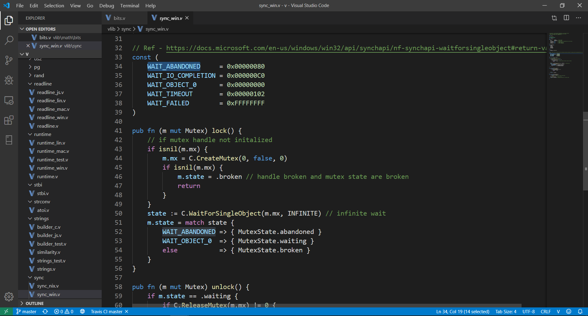

# V language support for Visual Studio Code

[](https://marketplace.visualstudio.com/items?itemName=vlanguage.vscode-vlang)
[](https://github.com/vlang/vscode-vlang/actions/)

Provides [V language](https://vlang.io) support for Visual Studio Code.

## Preview



## Features

### Code Editing

- Syntax highlighting for `.v`, `.vsh`, `.vh`, `.vv`, plus `v.mod` files
- Code snippets for quick coding, including a dozen `veb` snippets
  (`vapp`, `vget`, `vpst`, `vpar`, `vctx`, `vtml`, `vif`, `vfor`, `vinc`,
  `vjsn`, `vmid`, `vctl`)
- Completion, diagnostics, navigation, inlay hints, and other language
  features via VLS
- Runnable CodeLens actions for `main` and tests (`Run Main`, `Run File`,
  `Run Test`, `Debug Main`)
- Workspace build, run, and test tasks
- Test coverage highlighting and a status bar summary
- Code folding for blocks, import runs, and `//#region` markers
- Document formatting with the configured compiler, deferring to VLS
  while the server is running
- Works in unsaved (`untitled`), diff (`git`), and `v.mod` documents,
  not just saved `.v` files

### V Language Server

Install [VLS](https://github.com/vlang/vls) and ensure the `vls`
executable is in PATH. Alternatively, set `v.vls.command` to its
absolute path. The extension starts VLS over stdio when a V workspace
is opened.

The VLS owner version-gates the server, serializes starts and restarts,
recovers a crashed server, and reports the state on the status bar.
`V: Restart VLS` restarts it; `V: Open V Language Server Output` shows
its log. An unsupported server version offers `V: Update VLS` when the
server names itself VLS, otherwise it points at the settings.

The available VLS settings are:

- `v.vls.enable`: enable or disable VLS
- `v.vls.command`: path or command name for the VLS executable
- `v.vls.args`: additional command-line arguments
- `v.vls.inlayHints.enabled`: enable or disable inlay hints
- `v.vls.inlayHints.variableTypes`: show inlay type hints
- `v.vls.inlayHints.parameterNames`: show inlay parameter-name hints
- `v.vls.diagnostics`: enable or disable live diagnostics
- `v.vls.defines`: compile-time defines VLS checks with, e.g. `["-d", "flag"]`
- `v.vls.coverageDirectory`: directory a `v -coverage` run recorded into; enables
  VLS "Generate test" actions for untested functions
- `v.vls.coverage.enabled`: collect coverage during test tasks and highlight
  covered and uncovered executable lines
- `v.executablePath`: V compiler used by VLS and tasks; supports absolute
  paths, `~`, `${env:NAME}`, and `${workspaceFolder}`

Settings from the former VLS extension (`vls.command`, `vls.args`,
`vls.vCommand`, and its inlay hint, diagnostics, and coverage toggles) remain
effective until replaced by the corresponding `v.*` settings.

### Build, run, and test

Use `V: Build`, `V: Run`, or `V: Test` in the Command Palette, or select a V
task from `Tasks: Run Task`. Build, Run, and Test operate on the workspace;
Run uses the active V module or script when one is open, and Test uses the
active `_test.v` file. The extension saves modified V files in the target
before running.

`V: Run current file` uses the same run task. For a `.v` file, it runs the
containing module; for a `.vsh` file, it runs the script. `V: Build an
optimized executable from current file` builds the active file with `v -prod`.

VLS CodeLens actions such as `Run Main`, `Run File`, and `Run Test` use the
same tasks. Test runs collect coverage by default. Covered executable lines
are highlighted green and uncovered lines red. Click the coverage status
item or run `V: Clear Test Coverage` to remove the highlights.

Three more tasks run the gates that the rest of a change hangs on. Each works on
the active file when one is open, and on the workspace otherwise.

- `V: Check` runs `v -check`, which type-checks without producing a binary
- `V: Vet` runs `v vet -W`, which reports suspicious constructs and treats
  warnings as errors, so it is the one to use in CI
- `V: Format Check` runs `v fmt -verify`, which reports whether the formatter
  would change anything

All three surface through the `vls` problem matcher, so a failure lands in the
Problems panel at the right line rather than only in the task output.

### Tests: generate, toggle, fill, explore

- **V: Generate Test File** creates the `_test.v` file beside the source with
  one `test_` function per public function, each with a placeholder assertion.
  It asks before overwriting an existing test file.
- **V: Toggle Test File** jumps both directions: from a source file it opens
  its `_test.v` file, and from a `_test.v` file it opens the source beside it.
- **V: Generate Tests for Untested Functions** plans new tests from a coverage
  run: point `v.vls.coverageDirectory` (or `vls.json`) at a `v -coverage`
  directory and it appends one `test_` per untested function.
- **V: Generate Test from Coverage** asks the running VLS (`vls.generateTest`,
  via `v cover --write-tests`) to write tests for the active file.
- **V: Fill Struct Fields** fills an empty `Name{}` literal with the fields
  of the `struct Name` declared in the same file.
- Every `_test.v` file also appears in the Test Explorer, with one item per
  `test_` function. Running a test from there executes `v test` on its file with
  `VTEST_ONLY_FN` set to the selected function. A gutter lens over each
  `fn test_` runs it through the same task path.

### Editor helpers: Error Lens, paths, import cost

- **Error Lens** (`v.errorLens.*`, `V: Toggle Error Lens`) decorates V
  diagnostics inline: full-line backgrounds per severity, problem-range
  highlights, and the message appended at the end of the line. Settings:
  `enabled`, `enabledDiagnosticLevels` (`error`, `warning`, `info`, `hint`),
  `messageEnabled`, `messageMaxChars`, `messageTemplate`
  (`$message`, `$severity`, `$source`, `$code`), and `delay`.
- **Path Intellisense** (`v.pathIntellisense.*`) completes file names inside
  string literals in `.v` files and inside template files. Settings:
  `enabled`, `showHiddenFiles`, `autoSlashAfterDirectory`,
  `autoTriggerNextSuggestion`, `absolutePathToWorkspace`, and `mappings`
  (supports `${workspaceFolder}` / `${workspaceRoot}`).
- **Import Cost** (`v.importCost.*`) annotates each `import` line with the
  module's source size, e.g. `// 14.2 KB (312 lines, 6 files)`. V compiles
  whole programs, so this is module size, not a tree-shaken bundle delta.
  Settings: `enabled`, `includeTests`, `cacheTtlMs`.

### Web templates (HTML/CSS/JS, React, Tailwind)

Template files stay HTML — the extension injects VEB directive highlighting
(`@if`, `@for`, `@else`, `@end`, `@include`, `@var`, `${...}`, `@{...}`) into
`text.html.basic` instead of replacing the language. Emmet, Tailwind CSS,
Prettier, ESLint and React extensions keep working.

Recognized templates: `.html` under `templates/`, plus `.vhtml` and `.vtml`
(which default to HTML via `files.associations`). Hovering a directive shows
its kind and the auto-detected script flavor; path completion works inside
template strings too.

Settings:

- `v.templates.jsxAutoDetect`: auto-detect JSX/TSX in template script blocks
- `v.templates.enableEmmet`: recommend Emmet for HTML templates
- `v.templates.enableTailwind`: recommend Tailwind CSS IntelliSense

For Tailwind, include `./templates/**/*.{html,vhtml,vtml}` in your `content`
glob. React works inside `<script type="text/babel">` blocks (JSX
auto-detected) or in dedicated `.jsx`/`.tsx` files.

### Data tools: decoders, encodings, C interop

- On a JSON file, **V: Generate JSON Decoder** infers V structs for the
  document and opens them as an untitled V file, with a decode example
  using `json2`. **V: Generate XML Decoder** and **V: Generate CSV
  Decoder** do the same from XML (strict subset, struct shape only —
  vlib has no struct decoder, so the example loads the document for the
  query API) and CSV (columns typed across rows) files. TOML and YAML
  share the same core and follow once their parsers land as declared
  dependencies.
- Protobuf, ASN.1, PEM, CBOR and raw binary payloads carry no field
  names without a schema, so struct inference does not apply to them;
  base64, hex, base32 and base58 are encodings, covered by
  **V: Convert Selection Encoding** instead.
- **V: Generate C Output** saves the active file, then shows the C the
  compiler emits for it (`v -o - <file>`); V compiles files rather than
  standard input, so an unsaved buffer cannot be translated as-is.
- **V: Translate C File to V with c2v** translates the active `.c` file,
  offering to install `c2v` when it is missing.
- **V: Organize Imports** sorts (and de-duplicates, where safe) the import
  block; **V: Fill Struct Fields** is also available as a refactor action.
- Hovering a non-decimal literal (`0x`, `0o`, `0b`) shows its decimal value.

### VPM and playground

- **V: Search VPM Modules**, **V: List Installed VPM Modules** search and list
  modules from the V package manager.
- **V: Share on Playground** posts the active file to the V playground share
  API and copies/opens the link.

### Toolchain: install, update, status

- **V: Install or Update V** and **V: Update VLS** build the pinned revision
  from source (managed builds, preferred over PATH once installed).
- **V: Select V executable** picks between the configured value, the compiler
  on PATH, and a managed build.
- **V: Show V version** prints `v version`.
- **V: Show Environment Status** reports which `v` and which VLS the extension
  resolved, what versions they report, and whether the server is running. The
  answer is written to a document so it can be copied into a bug report.
- **V: Check for Updates** checks once a day (workspace trust required).
- Settings: `v.tools.updateChannel` (`master` follows the latest commit,
  `release` follows the latest tag), `v.tools.checkForUpdates`.
- The status bar shows the resolved V and VLS separately, because VLS can be
  down while V works; a missing tool offers the fix on click.

### Agents: the V compiler as an MCP server

The extension offers the V compiler to agents over the
[Model Context Protocol](https://modelcontextprotocol.io), one server per
workspace folder. `v mcp serve` calls the V parser, checker and formatter in
process, so its answers hold for code that does not compile yet — which a
language server working from a failed parse cannot manage. It also carries the
standard library documentation, so an agent can look up a signature instead of
guessing one.

This needs a V that supports `v mcp`. The extension probes `v mcp tools` per
compiler and quietly offers nothing when the compiler is too old; a failed
probe is retried rather than cached, so installing a newer V mid-session is
picked up. Nothing is started until an agent calls a tool. `v.mcp.*` are
resource-scoped, so each workspace folder carries its own enable flag,
read-only mode, and root.

The server starts read-only by default, which registers no tool that writes a
file. Three of the eighteen tools write: `v_rename_symbol`, which defaults to a
dry run listing every position it would change; `v_format`, which reports its
diff before writing; and `v_edit_replace`, which has no preview at all — it
writes as soon as the range matches the text the agent passed back, so passing
that text is what approves the edit. Set `v.mcp.readOnly` to `false` to offer
them.

The settings are:

- `v.mcp.enable`: offer the compiler to agents (default `true`)
- `v.mcp.readOnly`: start read-only, withholding the three writing tools
  (default `true`)
- `v.mcp.root`: directory the server resolves paths against; empty means each
  workspace folder

Agents outside VS Code can use the same server, and the skills the compiler
ships, without this extension. See `v mcp --help` and `v skills --help`.

### Agents: VLS as an MCP server

VLS is offered as an MCP server over stdio (`vls --mcp`) when the configured
VLS answers an MCP handshake: compile checks, hover, definitions, references,
rename, symbols, and completion. The extension probes the binary before
registering anything, and quietly offers nothing when the installed VLS
cannot serve MCP (no VLS verified so far answers the handshake). One VLS
server per workspace folder sits behind `v.vls.mcp.enable` (default `false`,
resource-scoped). Both MCP providers (`V Compiler`, `V Language Server`)
appear in VS Code once enabled.

### Agents: the bundled V agent skills

The compiler ships agent skills — the rules that make V code which looks right
fail to compile, the build and test loop, testing conventions, concurrency, the
memory model, and how to drive the MCP server. `v skills` installs them into
`.agents/skills/<name>/`, which VS Code, Claude Code, opencode and Copilot
already read, so one install improves every agent you use. A project install
lands in the repository and is shared with your team; a user install lands in
`~/.agents/skills` and applies to every project on the machine.

The extension adds commands around that rather than a copy of it:

- `V: Install V Agent Skills` reads the compiler's catalog, lets you pick skills
  and a scope, and runs the install
- `V: Show V Agent Skill Status` says what is installed where and which copies
  have fallen behind the compiler's
- `V: Update V Agent Skills` refreshes the ones that have
- `V: Remove V Agent Skills` removes installed skills per scope
  (`v skills remove`, new in recent V)

Nothing is overwritten silently. `v skills add` refuses to replace an installed
skill unless `--force` is given, which the extension passes only for the
picked skills that are already installed; freshly picked skills install
without it, so one reinstall cannot overwrite the rest. `v skills update`
holds back a skill whose files were edited locally, and reports which one
and why.

These commands need a V that supports `v skills`. On an older compiler they
report that rather than doing nothing. Skills also work with agents outside VS
Code, without this extension; see `v skills --help`.

## Roadmap

Known gaps and what would close them, cheapest first — the missing Test Explorer
integration, the absent debugger, and the parts of the test suite that fail on
Windows. See [ROADMAP.md](./ROADMAP.md); please read it before opening a pull
request so we do not duplicate each other.

## Usage

The first time you open a V file, the extension offers a three-step walkthrough:
install V, build and run a project, and run the check, vet and format gates. Each
step completes when you run the command it describes, so the walkthrough walks you
through the extension's own commands rather than asking you to read this file
first.

First you will need to install [Visual Studio Code][vs-code] >= `1.105`.
In the command palette (`Cmd+Shift+P`) select `Install Extensions` and choose `V`.
Alternatively you can install the extension from the [Marketplace][market-ext-link].
Now open any `.v`, `.vsh`, `.vh`, or `.vv` file in VS Code.

_Note_: It is recommended to turn `Auto Save` on
in Visual Studio Code (`File -> Auto Save`) when using this extension.

## Commands

- `V: Build`, `V: Run`, and `V: Test`
- `V: Check`, `V: Vet`, and `V: Format Check`
- `V: Run current file`
- `V: Format current file`
- `V: Build an optimized executable from current file`
- `V: Generate Test File`
- `V: Toggle Test File`
- `V: Generate Tests for Untested Functions`
- `V: Generate Test from Coverage`
- `V: Fill Struct Fields`
- `V: Organize Imports`
- `V: Clear Test Coverage`
- `V: Debug Main`
- `V: Generate JSON Decoder`
- `V: Generate XML Decoder`
- `V: Generate CSV Decoder`
- `V: Convert Selection Encoding`
- `V: Generate C Output`
- `V: Translate C File to V with c2v`
- `V: Share on Playground`
- `V: Search VPM Modules`
- `V: List Installed VPM Modules`
- `V: Install V Agent Skills`
- `V: Show V Agent Skill Status`
- `V: Update V Agent Skills`
- `V: Remove V Agent Skills`
- `V: Toggle Error Lens`
- `V: Show V version`
- `V: Select V executable`
- `V: Install or Update V`
- `V: Update VLS`
- `V: Restart VLS`
- `V: Open V Language Server Output`
- `V: Show Environment Status`
- `V: Check for Updates`

You can access all of the above commands from the command palette (`Cmd+Shift+P`).

## Debug the extension

Clone this repository and run `npm install` to install the dependencies.
Then press `F5` to open a new VS Code window with the extension loaded.

The build, test, and grammar-test commands, and the layout of `src/`, are
described in [CONTRIBUTING.md](./CONTRIBUTING.md).

Open the output console (`Cmd+Shift+U`) to see the debug output from the extension.

Run `Cmd+Shift+P` and select `Preferences: Open User Settings` to update settings.

Run `npm test` for logic checks and `npm run test:vscode` for an extension-host
check. The latter uses `~/code/vls/vls` and `~/code/v/v` by default and downloads
a local VS Code test build if `CODE_EXECUTABLE` is unset. Set `VLS_BINARY` and
`V_BINARY` to use other binaries. After `npm run package`, set
`TEST_PACKAGED=1` when running `npm run test:vscode` to install and test the
VSIX in an isolated VS Code profile.

## Debugging

V has no native debugger. The pipeline is `v -g` -> C -> DWARF -> gdb DAP:
the extension compiles the program with `-g`, then drives the session through
gdb's own Debug Adapter Protocol server (`gdb -i=dap`). Requires gdb >= 13
(for DAP). lldb is not supported in this version. The C/C++ extension
(`ms-vscode.cpptools`) is optional: when installed, the session may delegate
to its `cppdbg` adapter for features gdb DAP does not provide.

A default launch configuration is provided, so starting a debug session does not
require writing a `launch.json` by hand. The `program` field is the V source file
to debug; `args`, `stopAtEntry` and `cwd` are optional. `miDebuggerPath` names
the MI debugger (a path or a command on PATH, with `~` expanded) and `MIMode`
selects `gdb` or `lldb`; both default to gdb on PATH. `setupCommands` passes
extra commands through, `environment` and `envFile` set the program environment,
`externalConsole` runs it outside the integrated terminal, and `sourceFileMap`
maps build paths to local source paths.

Attach works with `"request": "attach"`: `program` names the running binary for
symbols (nothing is compiled), `processId` takes a PID or
`${command:v.pickProcess}`, and `coreFile` opens a core dump. `sourceFileMap`,
`miDebuggerServerAddress` and `pipeTransport` reach remote targets (cppdbg
fallback only).

A `Debug Main` lens over `fn main` starts the same pipeline without a launch
configuration. Panics stop in the debugger instead of exiting: debug builds trap
on panic while a debugger is attached.

Hexadecimal display is per variable, not a launch option: in the Debug Console,
`-exec -var-set-format <name> hex` reformats a value.

Each session loads GDB pretty printers for V values when
`v.debug.usePrettyPrinters` is true: strings show as text, `Option` and
`Result` show their payload, and arrays and maps summarize their lengths. This
needs a GDB with Python support; without it the session still runs, only
without the pretty display. If the printers fail to load, a warning is printed
in the debug console and the session continues.

Feature matrix:

| Feature | gdb DAP | cppdbg fallback |
|---|---|---|
| launch | yes | yes |
| attach | yes | yes |
| core-file attach | yes | no |
| externalConsole | no (use integrated terminal) | yes |
| pipeTransport | no | yes |
| remote ssh | no | yes |

## Licensee matrix:

| Feature | gdb DAP | cppdbg fallback |
|---|---|---|
| launch | yes | yes |
| attach | yes | yes |
| core-file attach | yes | no |
| externalConsole | no (use integrated terminal) | yes |
| pipeTransport | no | yes |
| remote ssh | no | yes |

## License

The extension is distributed under [GPL-2.0-only](./LICENSE) because its
task and coverage implementation comes from the VLS VS Code extension.
Existing files covered by the [MIT license](./LICENSE.MIT) retain that license.

## API

Other extensions can resolve the V compiler through the extension's exports:

```ts
const v = vscode.extensions.getExtension("vlanguage.vscode-vlang")?.exports
const compiler = v?.resolveV(resource)
```

`resolveV` returns the absolute path to the `v` binary the extension would use
for that resource, including the settings kept from the former VLS extension.
It returns `undefined` when the compiler cannot be resolved, which is not the
same as it being absent.

<!-- Links -->

[vs-code]: https://code.visualstudio.com/
[market-ext-link]: https://marketplace.visualstudio.com/items?itemName=vlanguage.vscode-vlang
